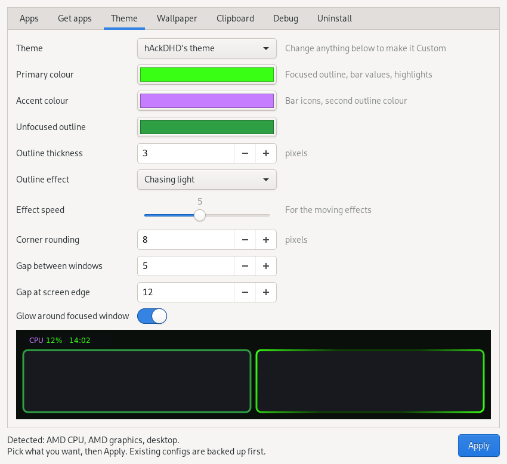
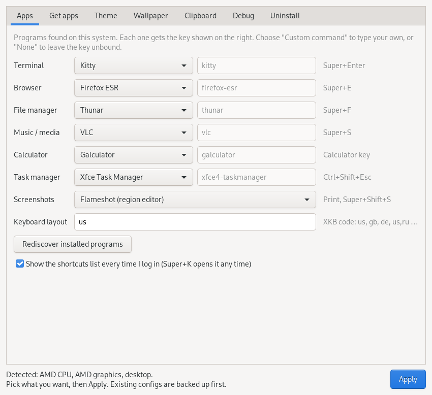
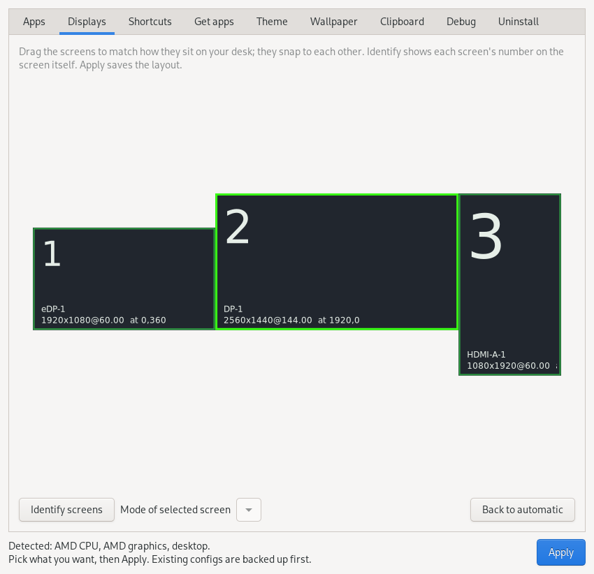
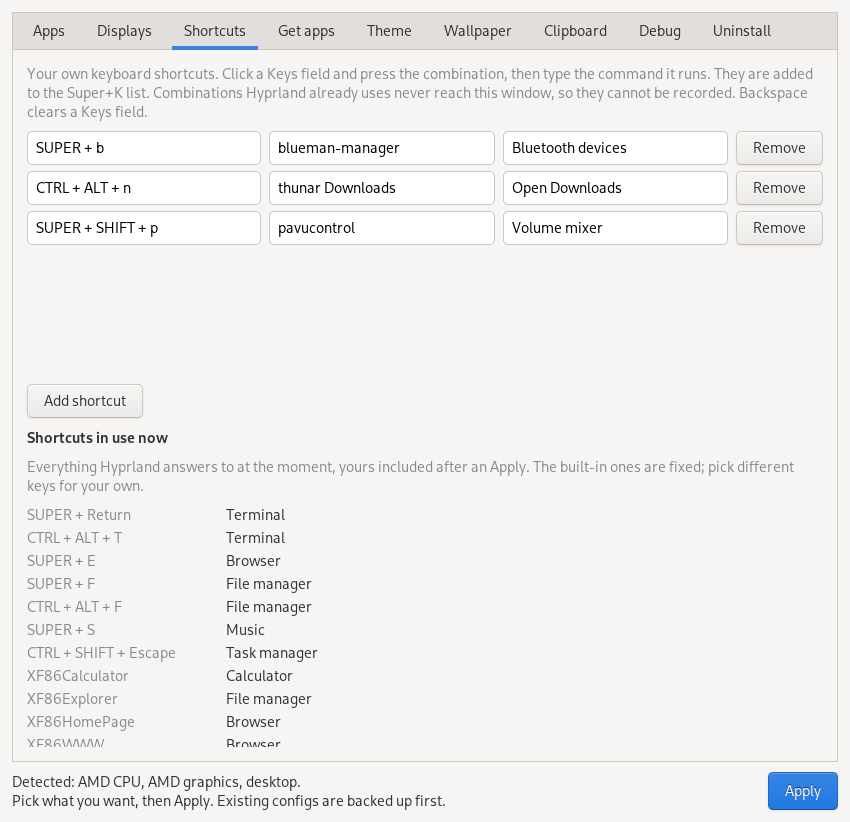
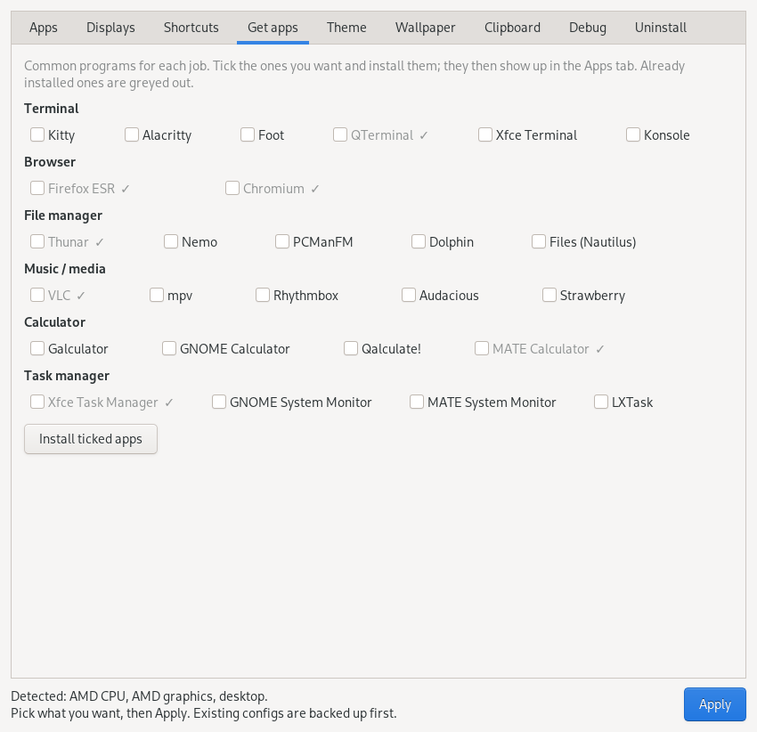
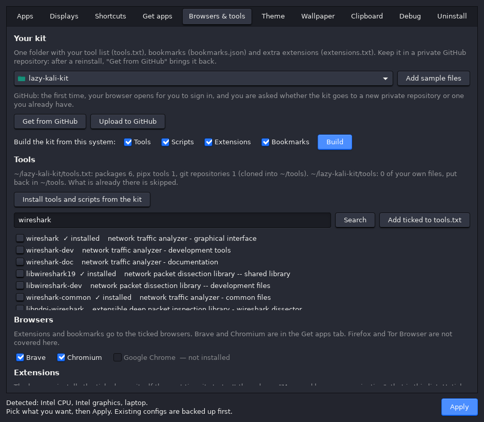
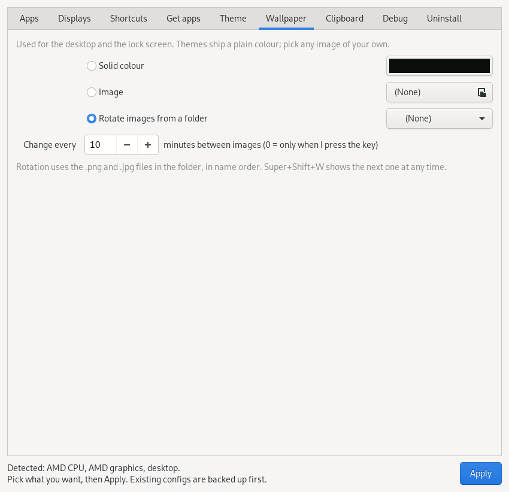
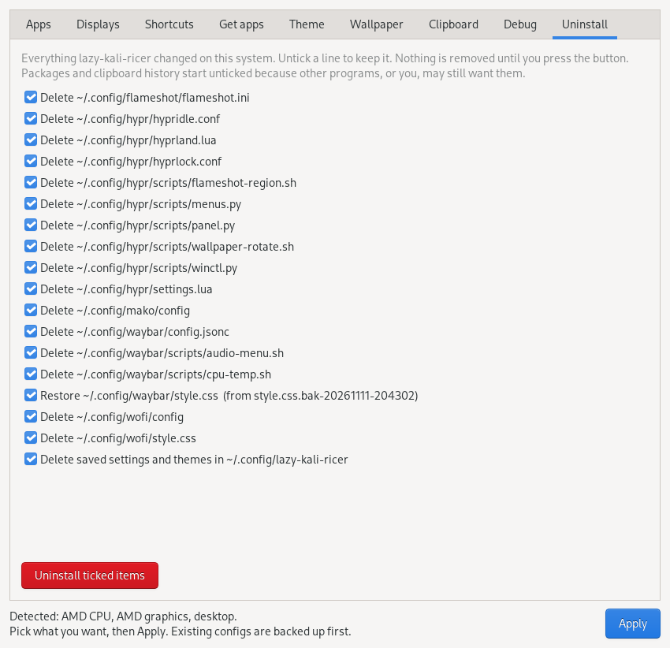

# lazy-kali-ricer

*This is vibe-coded with fable 5.2. The goal was to see how well the tool worked and im happy*

Rice Hyprland on Kali from a GUI. Pick your apps, a theme, a wallpaper and clipboard
options, press **Apply**. No config files to edit.

- **Finds your programs.** Terminal, browser, file manager, music player: pick from what is installed.
- **Themes.** Six ready ones, or build your own: outline colour, thickness and animated effects. Save yours under a name.
- **Screen layout by drag and drop.** Arrange your monitors, with an Identify button.
- **Your own shortcuts.** Press a key combination, give it a command.
- **Get more apps.** Tick to install: terminals, browsers (Brave, Tor Browser), code editors (VS Code, VSCodium), notes, screenshot and recording tools, chat (Discord, Signal, Matrix, WhatsApp), music (Spotify, Amazon Music, YouTube Music) and more, each with its icon.
- **Your setup back in minutes.** Your tool list, your own scripts, browser extensions and bookmarks live in a kit folder. One Build button fills it from the system you are on; two buttons keep it in a private GitHub repository.
- **Your wallpaper.** One image, a plain colour, or a folder that rotates on a timer or a key.
- **Adapts to the machine.** Laptop or desktop, AMD or Intel CPU, AMD, NVIDIA or Intel graphics.
- **Safe to try.** Existing configs are backed up before anything is written.
- **Shortcut list.** Opens at login until you tell it not to; Super+K any time.

It sets up Hyprland (Lua config), Waybar, wofi, mako, hyprlock and, on laptops, hypridle.


*hAckDHD's own desktop: hAckDHD's theme with a personal wallpaper. Themes ship colours and style; the wallpaper is yours to pick.*



<details>
<summary>More screenshots</summary>

**Apps:** pick from the programs found on your system.



**Displays:** drag the screens to match your desk.



**Shortcuts:** press a key combination, give it a command.



**Get apps:** install common programs with a tick.



**Browsers & tools:** your kit: tool list, scripts, extensions, bookmarks, and GitHub.



**Wallpaper:** a colour, an image, or a rotating folder.



**Uninstall:** every change listed; untick what you want to keep.



</details>

## Install

```bash
git clone https://github.com/hAckDHD/lazy-kali-ricer lazy-kali-ricer
cd lazy-kali-ricer
./install.sh
```

`install.sh` installs the packages with apt (git included), adds the `lazy-kali-ricer` command to
`~/.local/bin`, and opens the GUI. Nothing in `~/.config` changes until you press Apply.
Any config file that was already there is moved to `<name>.bak-<timestamp>` first.

Needs a Hyprland build with Lua config support (Kali's `hyprland` package has it).

Whenever the GUI needs your password (installing apps, setting browser extensions) it asks in a
dialog, also when you started it from a terminal.

## The GUI

| Tab | What you choose |
|-----|-----------------|
| **Apps** | Terminal, browser, file manager, music, calculator, task manager. The lists show what is installed on your system (Flatpaks included); "Rediscover installed programs" rescans after you install something. You can type a custom command or pick None. Also the screenshot tool (Flameshot or grim + slurp), keyboard layout, and whether the shortcut list opens at login. |
| **Displays** | Drag your screens into place; they snap together. Pick a resolution per screen. Identify shows each screen's number on the screen itself. |
| **Shortcuts** | Your own keyboard shortcuts: press the keys, type the command. They join the Super+K list. |
| **Get apps** | Common programs with their icons, grouped by job: terminals, browsers, file managers, code editors, notes, screenshots and recording, chat, everyday apps, wordlists. Tick, install, and they appear in the Apps tab. See [What Get apps installs](#what-get-apps-installs). |
| **Browsers & tools** | Your kit: tool list, your own scripts, and extensions and bookmarks for Brave, Chromium and Chrome. Build it from this system, keep it on GitHub, put it back after a reinstall. See [Your kit](#your-kit). |
| **Theme** | A ready theme, or Custom: primary, accent and unfocused outline colours, outline thickness, outline effect and speed, corner rounding, gaps, glow. A preview shows the result. Type a name and "Save as theme" to keep your look in the list. |
| **Wallpaper** | A solid colour, one image, or a folder of images that rotates. Also sets the lock screen. |
| **Clipboard** | Clipboard history on/off, how many entries, images or text only, and the privacy options below. |
| **Update & debug** | Check for updates, update, go back to the previous version. Logging switch and a button that saves a report. |
| **Uninstall** | Every change it made, one line each. Untick what you want to keep. |

### What Get apps installs

Everything comes from Kali's package sources, or from the app's own maker when Kali does not carry it.
In that case the maker's apt repository is added (Brave, VS Code, VSCodium, Sublime Text, Signal,
Element) or the maker's `.deb` is downloaded over HTTPS (Discord, Vesktop, WebCord).

| Group | Apps |
|-------|------|
| Browser | Firefox ESR, Chromium, Brave, Tor Browser |
| Music / media | VLC, mpv, Rhythmbox, Audacious, Strawberry, Spotify, Amazon Music, YouTube Music |
| Code editor | VS Code, VSCodium (the build without Microsoft's telemetry and branding) |
| Notes and text editors | Obsidian, Sublime Text, Joplin, CherryTree. Notion has no Linux app, so it is not listed; use it in the browser. |
| Screenshots and recording | Flameshot, grim, slurp, Swappy, Ksnip, OBS Studio, wf-recorder |
| Chat | Discord, Vesktop, WebCord, Signal, Element and Nheko (Matrix), WasIstLos (WhatsApp), Telegram |
| Everyday | LibreOffice, GIMP, Thunderbird, KeePassXC, qBittorrent, Remmina, btop, fastfetch, Timeshift, GParted |
| Wordlists | SecLists (in `/usr/share/seclists`) |

**Discord.** Three ways in, all of which load the real discord.com; none is a look-alike site or a relay:

- **Discord (official)**, from discord.com.
- **Vesktop**, by the Vencord developers: an open-source app with Vencord built in. Works better on Wayland, screen sharing included.
- **WebCord**: an open-source app that blocks Discord's tracking requests.

**Vencord on Discord** (bottom of the tab) adds Vencord to the official app with Vencord's own
installer. Discord downloads itself the first time it opens, so the order is: install Discord, press
**Open Discord**, let it update, close it, press **Add Vencord**. A Discord update can remove it; add
it again. Vencord, Vesktop and WebCord are not made by Discord, and Discord's terms do not allow
modified clients.

**Amazon Music and YouTube Music** have no Linux app. Ticking one adds a launcher that opens the real
site (music.amazon.com, music.youtube.com) in a window of its own, using Brave, Chromium or Chrome.
Nothing third-party is installed. Spotify is Spotify's own package from its apt repository.

**WhatsApp** has no Linux app of its own. WasIstLos is an open-source window around web.whatsapp.com,
packaged by Debian.

### Your kit

The kit is one folder, `~/lazy-kali-kit` unless you choose another, with three files and a folder you own:

| File | What it holds |
|------|---------------|
| `tools.txt` | What to install: `apt` packages, `pipx` tools, `git` repositories (cloned into `~/tools`) |
| `bookmarks.json` | Your browser bookmarks |
| `extensions.txt` | Extra browser extensions, by Chrome Web Store id |
| `tools/` | Your own scripts and folder layout: a copy of `~/tools` |

**Add sample files** in the Browsers & tools tab copies a template of each from
[`kit-sample/`](kit-sample) into the folder. Edit them; the comments in each explain the format.

**Build** fills the kit from the system you are on. Tick what you want, press Build:

- **Tools:** the packages you asked apt for by name (read from apt's log, about a year back),
  your pipx tools, and the git repositories in `~/tools`, added to `tools.txt`.
- **Scripts:** your own files and folders in `~/tools`, copied to the kit's `tools/` with the same
  layout (empty folders too). Left out: git checkouts (they are `git` lines in `tools.txt`),
  virtual environments and caches, and files over 5 MB.
- **Extensions:** the extensions you added to the ticked browsers, added to `extensions.txt`.
- **Bookmarks:** the bookmarks of the first ticked browser, written to `bookmarks.json`.

Tools and extensions are only added to, never removed; trim the files afterwards. Then
**Upload to GitHub**.

Putting it back, after a reinstall or on another machine:

- **Tools and scripts.** "Install tools and scripts from the kit" installs every `tools.txt` entry and
  puts the kit's `tools/` back in `~/tools`. What is already there is skipped; a file you already
  have in `~/tools` is never overwritten.
  **Search** looks a tool up by name in the package sources; tick results to add them to the file.
- **Extensions.** Bitwarden, Dark Reader, Wappalyzer, Sputnik, Read Aloud and whatever your
  `extensions.txt` lists; the ones in your kit come ticked. "Set extensions" hands the list to the
  browser, which installs them itself at its next start. You still sign in to each one. The
  browser shows "Managed by your organisation" while the list is in place.
- **Bookmarks.** "Import" replaces the bookmarks of the ticked browsers with a file: the kit's, the
  short sample form, or a `Bookmarks` file copied from any Chromium-family browser. Close the
  browser first. The previous bookmarks stay beside the new ones as `Bookmarks.bak-<time>`.

Brave, Chromium and Google Chrome are covered, first profile only. Firefox and Tor Browser are not.

#### Keep the kit in a private repository

Two buttons in the Browsers & tools tab do it:

- **Upload to GitHub** saves the kit folder to your GitHub account. The first time it asks:
  - **New repository:** give it a name; it is created for you, private.
  - **Existing repository:** type `owner/name` or paste its address. The folder's files go on
    top of what the repository already holds.

  After that, one press uploads whatever changed. If the repository is public you are warned
  first: your bookmarks are personal, and passwords or keys never belong in the kit.
- **Get from GitHub** brings the folder up to date. On a fresh install, where the folder does
  not exist yet, it asks which repository and downloads it.

Signing in happens in your browser: GitHub's sign-in page opens, and a small window shows a
one-time code to paste there (it is already on your clipboard). Nothing to set up by hand, and
nothing to type in a terminal; `git` comes with `install.sh`, and the GitHub command-line tool
`gh` is installed when first needed.

So after a reinstall: `./install.sh`, **Get from GitHub**, then Install tools and scripts, Set
extensions and Import.

### Themes

`hAckDHD's theme` (neon green + purple, chasing light), `Kali Dragon`, `Synthwave`,
`Blood Moon`, `RGB Rig`, `Ghost`. Themes are colours and style only; they ship no images.
Your saved themes live in `~/.config/lazy-kali-ricer/themes.json`.

### Outline effects

| Effect | What the focused window's outline does |
|--------|-----------------------------------------|
| Static | One colour |
| Gradient | Primary fades into accent |
| Spinning gradient | The same gradient, rotating |
| Chasing light | One band of light runs around the edge |
| Dual chase | A primary and an accent band chase each other |
| RGB rainbow | The full spectrum, rotating |

### Wallpaper rotation

Pick "Rotate images from a folder" and a folder of `.png` / `.jpg` files. They show in
name order and wrap around.

- **Timer:** set the minutes between images. 0 turns the timer off.
- **Key:** Super+Shift+W shows the next image at any time.

The lock screen then shows a blurred copy of whatever is on screen.

### Clipboard privacy

History stays on your computer, in `~/.cache/cliphist`. Nothing is sent anywhere.
By default everything you copy is kept, passwords included, up to 200 entries.

Optional, in the Clipboard tab:

- never store copies that a password manager marks as sensitive;
- wipe the history at every login;
- "Wipe history now" clears it at once.

## Hardware

Detected when Hyprland starts, so one install works if you move the disk or change the GPU.
The GUI shows what it found at the bottom of the window.

| Hardware | What happens |
|----------|--------------|
| **Laptop** (battery present) | Battery in the bar, brightness keys, touchpad tap and natural scroll, hypridle: dim, lock, screen off, suspend. |
| **Desktop** | No idle manager, no battery item. Lock with Super+L. |
| **AMD CPU** | Bar temperature from `k10temp` / `zenpower`. |
| **Intel CPU** | Bar temperature from `coretemp`. Other CPUs fall back to the kernel thermal zones. |
| **AMD graphics** | Video acceleration through `radeonsi`. Nothing else needed. |
| **Intel graphics** | Works as is. |
| **NVIDIA, proprietary driver** | Sets the NVIDIA Wayland environment, software cursor and explicit sync. Install the driver yourself first. |
| **NVIDIA, nouveau driver** | Treated like AMD/Intel; no NVIDIA settings forced. |
| **NVIDIA + Intel/AMD** (hybrid laptop) | Desktop runs on the integrated GPU; nothing forced. |

## Command line

```
lazy-kali-ricer                 open the GUI
lazy-kali-ricer apply           write the configs from the saved settings
lazy-kali-ricer update          get the newest version from GitHub and apply it
lazy-kali-ricer revert          go back to the version in use before the last update
lazy-kali-ricer version         show the installed version
lazy-kali-ricer debug on        mirror the Hyprland log to ~/.cache/lazy-kali-ricer/hyprland.log
lazy-kali-ricer debug off       stop mirroring
lazy-kali-ricer debug report    save ~/.cache/lazy-kali-ricer/debug-report.txt
lazy-kali-ricer uninstall       list every change and ask about each one
```

## Updating

In the **Update & debug** tab, or from a terminal:

- **Update** (`lazy-kali-ricer update`) gets the newest version from GitHub, writes your configs
  again with your saved settings, and reopens the window.
- **Go back to the previous version** (`lazy-kali-ricer revert`) returns to the version you had
  before the last update. Press it again to go one update further back.

Both refuse to run if you changed the tool's own files by hand, so nothing of yours is overwritten.
If an update leaves the window unable to open, `lazy-kali-ricer revert` in a terminal still works.

## Uninstall

Open the **Uninstall** tab, or run `lazy-kali-ricer uninstall` in a terminal. You get a
list of everything it would undo, and you decide line by line:

- each config file it wrote: your original is restored from its backup, or the file is
  deleted if there was none;
- the `lazy-kali-ricer` command, saved settings, debug logs;
- clipboard history (unticked by default);
- each package `install.sh`, the Get apps tab or your `tools.txt` added (unticked by default; asks for your password);
- the extension list given to each browser (asks for your password);
- the Amazon Music and YouTube Music launchers.

Not undone: imported bookmarks (rename `Bookmarks.bak-<time>` back yourself), scripts and
repositories put in `~/tools`, pipx tools, the kit folder and its GitHub repository, and the apt
repository entries added for Brave, VS Code, VSCodium, Sublime Text, Signal, Element, Spotify and the
GitHub tool. Vencord is removed
with its own button in Get apps.

Nothing is removed until you confirm. Packages that were already on your system before
`install.sh` ran are never offered.

## Something broke?

1. `lazy-kali-ricer debug on`
2. Reproduce the problem (log out and back in if Hyprland itself fails).
3. `lazy-kali-ricer debug report`
4. Attach the report to an issue, or paste it to an AI assistant.

The report holds versions, your settings, Hyprland config errors and the last 300 log
lines. Your home path, user name and host name are replaced. Read it before you share it.

## Keys

**Super+K** lists every keybinding. The list also opens at each login; choose
"Don't show this list on next login" at its top, or untick the box in the Apps tab. The main ones:

| Keys | Action |
|------|--------|
| Super+Space | App launcher |
| Super+Enter | Terminal |
| Super+E / Super+F / Super+S | Browser / file manager / music |
| Super+V | Clipboard history, images shown as thumbnails |
| Print, Super+Shift+S | Screenshot a region to the clipboard |
| Alt+Tab | Window picker with app icons |
| Super+M | Minimize; the bar counts minimized windows, click the count to restore one |
| Super+O | Float / un-float the window |
| Super+T | Tighten / loosen gaps |
| Super+Shift+W | Next wallpaper (when rotation is on) |
| Super+W | Close window |
| Super+L | Lock |

## Where things live

| Path | What |
|------|------|
| `lkr/core.py` | Themes, app detection, config rendering, debug report |
| `lkr/gui.py` | The GTK window |
| `lkr/kit.py` | Browser extensions, bookmarks, tool list |
| `kit-sample/` | Templates for your kit folder |
| `~/lazy-kali-kit/` | Your kit: `tools.txt`, `bookmarks.json`, `extensions.txt`, `tools/` |
| `~/tools/` | Your scripts, and the repositories `tools.txt` clones |
| `config/` | Config files, copied to `~/.config` on Apply with the theme colours filled in |
| `~/.config/lazy-kali-ricer/settings.json` | Your choices |
| `~/.config/hypr/settings.lua` | The same choices, as read by `hyprland.lua` |
| `~/.config/hypr/local.lua` | Optional, yours. Loaded last; Apply and Uninstall never touch it. |

Monitors are placed automatically until you arrange them in the Displays tab. For extra
keybinds, window rules or anything else the GUI does not cover, create
`~/.config/hypr/local.lua`; it is plain Hyprland Lua.

## Licence

MIT. See [LICENSE](LICENSE).
